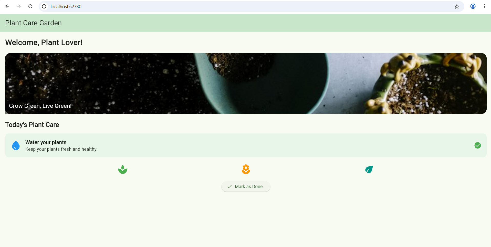
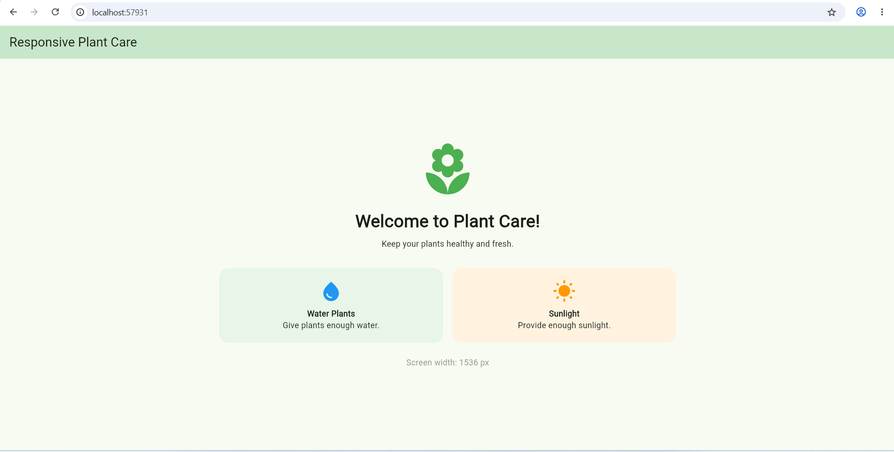
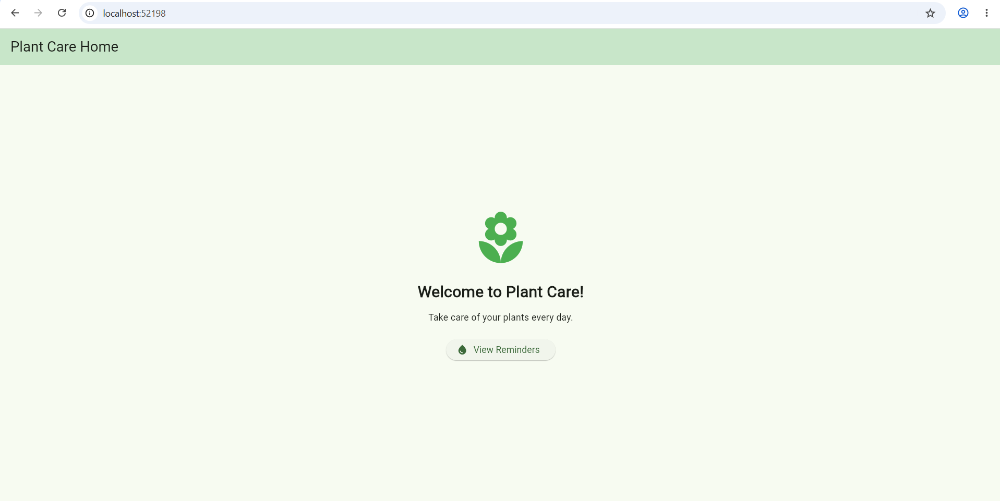
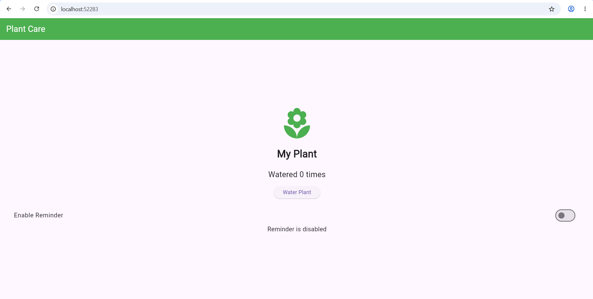
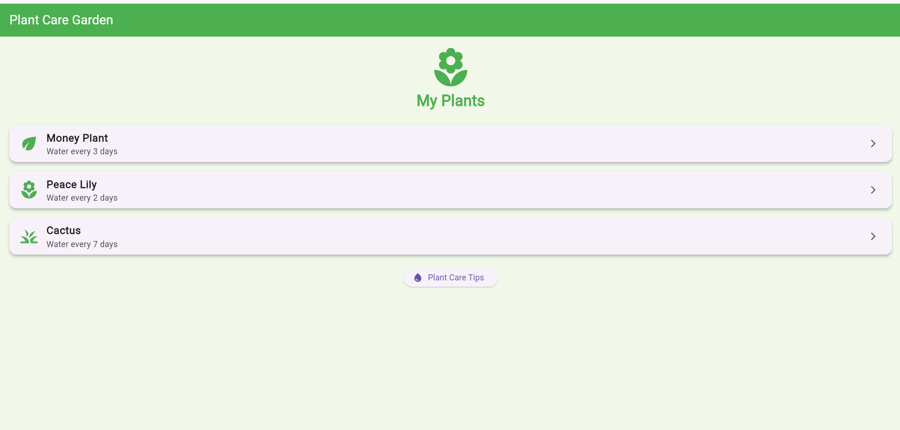
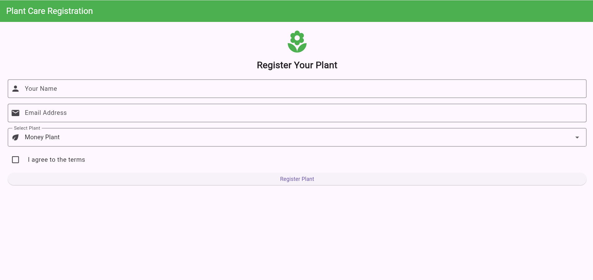
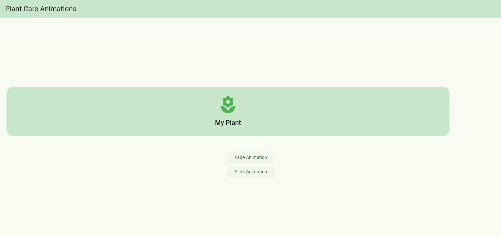
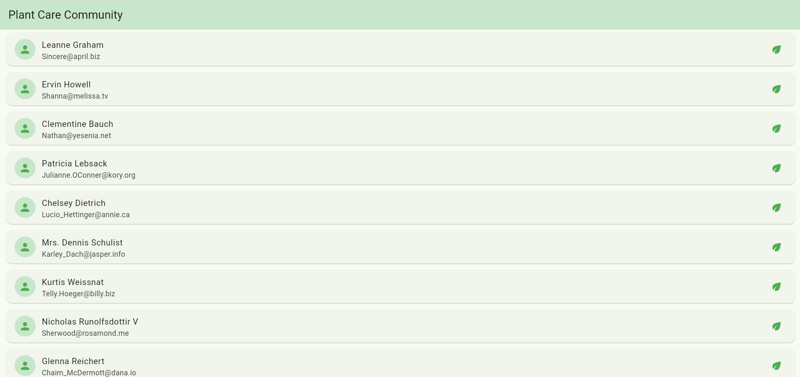

# Plant Care Water Reminder

A Flutter application developed as part of the Flutter lab syllabus.

## Experiment 1: Basic Flutter Application

### Aim
To create and run a basic Flutter application.

### Implementation
The application uses `MaterialApp`, `Scaffold`, `AppBar`, `Text`, `Icon`, `Column`, `Center`, and `ElevatedButton` to create the initial Plant Care Water Reminder screen.

**Source code:** [`lib/main.dart`](lib/main.dart)

### Output

## Technologies Used

- Flutter
- Dart
- Visual Studio Code
- Git and GitHub

## How to Run

1. Clone this repository.
2. Open the project folder in VS Code.
3. Run `flutter pub get`.
4. Run `flutter run`.

## Experiments

Screenshots, explanations, and implementation details will be added as each experiment is completed.

## Experiment 2: Flutter Widgets and Layouts

### Aim
To explore Flutter widgets and implement layouts using Row, Column, and Stack.

### Implementation
Implemented Text, Image, Icon, Container, ElevatedButton, Row, Column, and Stack widgets.

### Output

### Result
Successfully explored Flutter widgets and implemented different layout structures.

## Experiment 3: Responsive UI Using MediaQuery and LayoutBuilder

### Aim
To design a responsive user interface that adapts to different screen sizes.

### Implementation
Used MediaQuery to obtain screen dimensions and LayoutBuilder to adjust the layout for narrow and wide screens.

### Output

### Result
Successfully implemented a responsive Flutter user interface.

## Experiment 4: Navigation Using Navigator and Named Routes

### Aim
To implement screen navigation using Navigator and named routes in Flutter.

### Implementation
Created Home and Reminder screens and implemented navigation using Navigator.pushNamed() and Navigator.pop().

### Output

### Result
Successfully implemented navigation between multiple Flutter screens.

## Experiment 5: StatefulWidget, StatelessWidget and State Management

### Aim
To understand StatefulWidget, StatelessWidget and state management using setState() and Provider.

### Implementation
Created a Plant Care screen using StatelessWidget and StatefulWidget. Used setState() to control the reminder switch and Provider to update the plant watering count.

### Output

### Result
Successfully implemented Flutter widgets and state management using setState() and Provider.

## Experiment 6: Custom Widgets and Themes

### Aim
To create reusable custom widgets and apply themes and custom styles in Flutter.

### Implementation
Created a reusable PlantCard widget and applied a common application theme using ThemeData, along with custom text and card styles.

### Output

### Result
Successfully created reusable custom widgets and applied themes and custom styles in Flutter.

## Experiment 7: Forms and Validation

### Aim
To design forms using Flutter input widgets, validate user input, and handle errors.

### Implementation
Created a plant registration form using TextFormField, DropdownButtonFormField, CheckboxListTile, Form and GlobalKey<FormState>. Added validation and error messages.

### Output

### Result
Successfully implemented form input, validation and error handling in Flutter.

## Experiment 8: UI Animations Using Flutter Animation Framework

### Aim
To understand Flutter animations and implement fade and slide animations for UI elements.

### Implementation
Used AnimatedOpacity to create a fade effect and AnimatedPositioned inside Stack to move a plant card smoothly when a button is pressed.

### Output

### Result
Successfully implemented fade and slide animations in Flutter.

## Experiment 9: Fetching Data from a REST API

### Aim
To fetch data from a REST API, parse JSON, and display the results using Flutter widgets.

### Implementation
Used the HTTP package to send a GET request to a public REST API. Parsed the JSON response and displayed user details using ListView.builder. Implemented loading and error handling.

### Output

### Result
Successfully fetched and displayed REST API data in Flutter.
